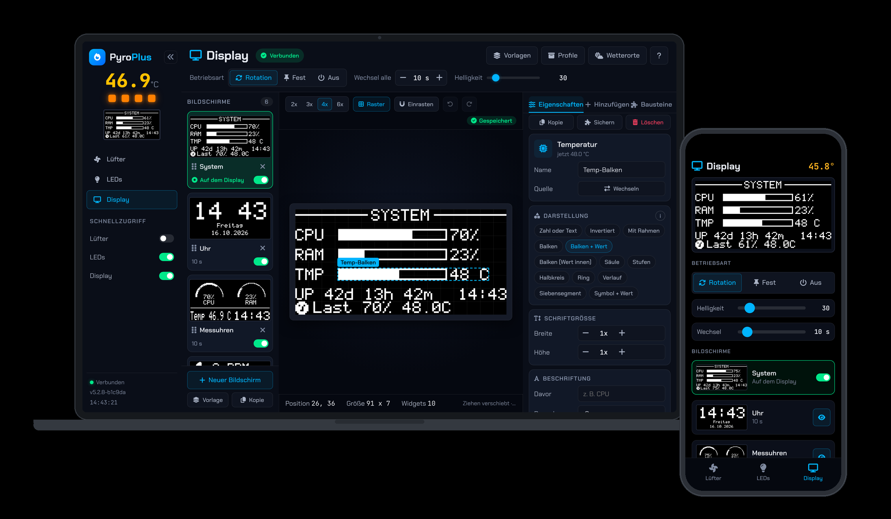
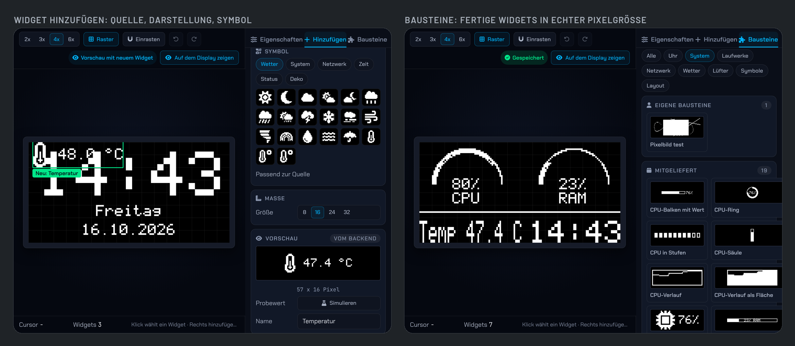
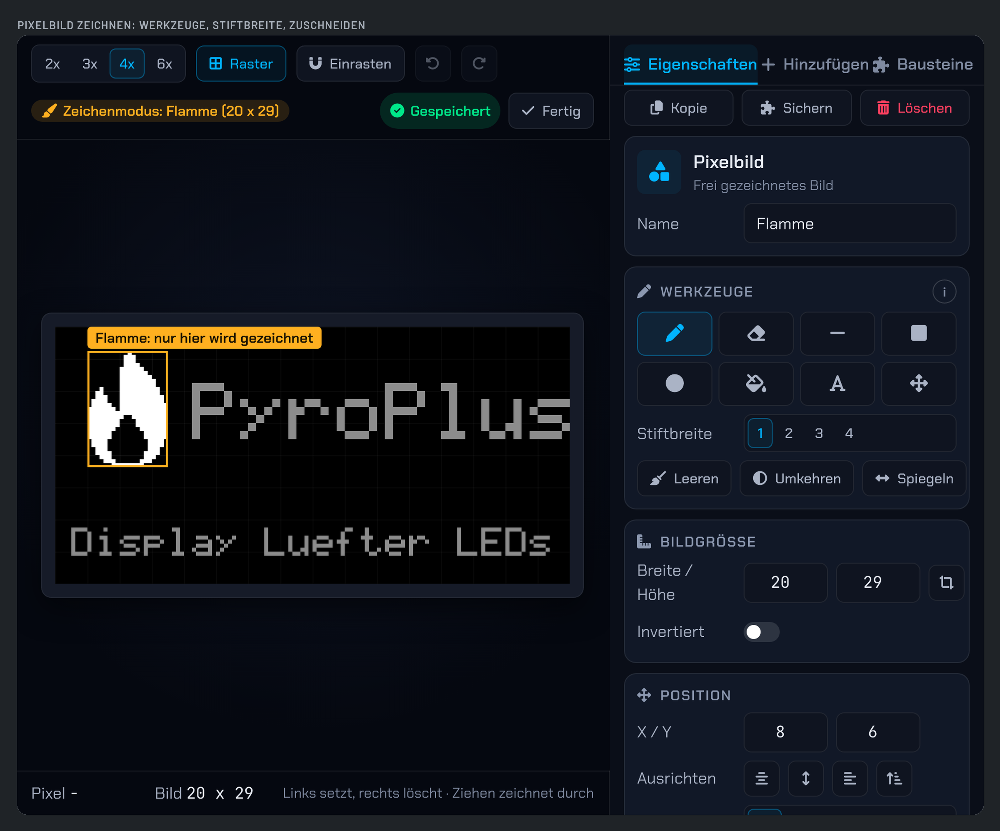
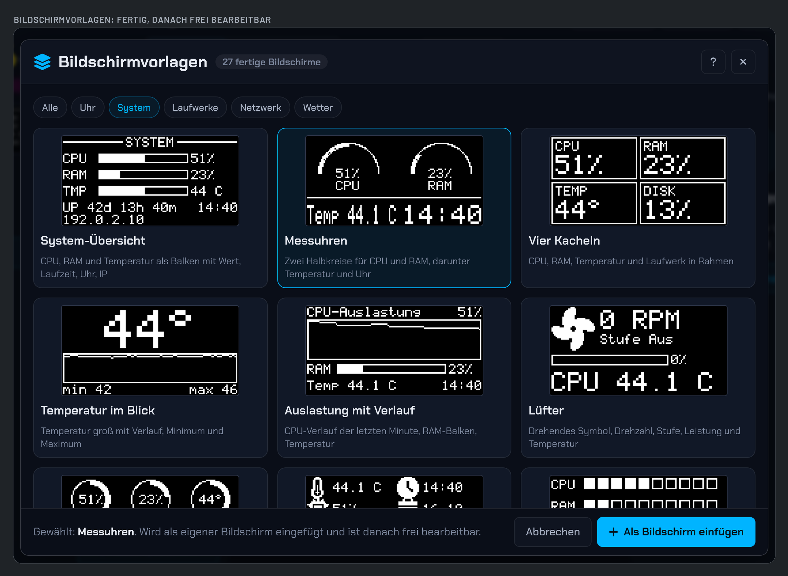
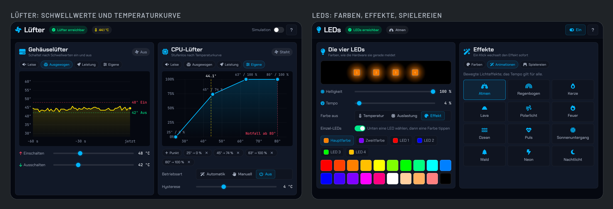
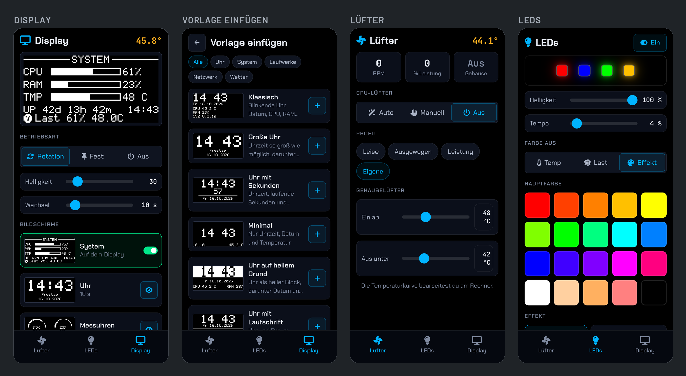

# PyroPlus

**Lüfter, LEDs und Display eines Raspberry-Pi-5-Gehäuses, gesteuert aus dem Browser.** PyroPlus regelt den Lüfter nach einer Temperaturkurve, färbt die vier LEDs und bespielt das kleine Display mit 128 mal 64 Pixeln: Bildschirme aus Widgets, fertige Vorlagen, eine Symbolbibliothek, eigene Pixelbilder und Wetter. Alles läuft auf dem Pi selbst, ohne fremde Dienste dazwischen.



## Auf einen Blick

- **Display-Editor im Browser:** Bildschirme aus Widgets zusammenstellen, per Ziehen anordnen, mit den Pfeiltasten pixelgenau schieben. Jedes Bild rendert das Backend; der Editor zeigt exakt, was auf dem Display erscheint.
- **27 fertige Bildschirme und 77 Bausteine:** Uhren, Digitaluhr, Systemübersicht, Ringe, Säulen, Stufen, Laufwerke, Netzwerk, Wetter. Einfügen und danach frei bearbeiten.
- **Symbolbibliothek:** über 130 Symbole in 8, 16, 24 und 32 Pixeln, aus derselben Symbolschrift wie die Oberfläche. "Symbol + Wert" wählt das passende Symbol zur Datenquelle von selbst.
- **Pixelbilder:** eigene Grafiken direkt im Editor zeichnen: Stift, Radierer, Linie, Rechteck, Ellipse, Füllen, Text. Zuschneiden, spiegeln, umkehren.
- **Daten vom Pi und von draußen:** CPU, Arbeitsspeicher, Temperatur, Laufwerke, Netzwerk, Lüfterdrehzahl, Laufzeit, Uhrzeit, Weltzeiten und Wetter für mehrere Orte. Eigene Werte lassen sich über die Schnittstelle melden.
- **Lüfter mit Kurve:** Der CPU-Lüfter folgt einer Temperaturkurve mit Profilen und Hysterese, der Gehäuselüfter schaltet nach Schwellwerten. Eine Simulation zeigt das Verhalten bei angenommener Temperatur.
- **LEDs:** Temperaturfarbe, Auslastung, feste Farben, Verläufe, Animationen und Spielereien, jede LED einzeln einstellbar. Die Seitenleiste zeigt die Farben, die die Hardware gerade meldet.
- **Telefon:** eigene Ansicht zum Sehen, Umschalten und Wählen; lässt sich auf den Startbildschirm legen.
- **Profile und Sicherung:** Zusammenstellungen sichern und wechseln, alles als eine Datei exportieren und wieder einlesen.

## Funktionen

### Display



- **Bildschirme:** beliebig viele, mit Name, Dauer und Schalter für die Rotation. Der grün markierte liegt gerade auf dem Display, der blaue wird bearbeitet. Reihenfolge durch Ziehen.
- **Widgets:** Datenquelle wählen, Darstellung wählen, fertig. Darstellungen: Zahl oder Text, invertiert, mit Rahmen, Siebensegment, Symbol + Wert, Balken (waagerecht, mit Wert, Wert innen, Säule, Stufen), Halbkreis, Ring, Verlauf als Linie oder Fläche, Laufschrift, Lüftersymbol, Symbol, Linien, Rahmen, Blöcke, Trennlinien und Pixelbild. Schriftgröße, Beschriftung, Dezimalstellen, Ausrichtung und Drehung je Widget.
- **Probewert:** vor dem Einfügen mit einem angenommenen Wert prüfen, wie die Darstellung bei 50 Prozent oder 80 Grad aussieht.
- **Bearbeiten:** Kopie, Sichern und Löschen direkt oben in den Eigenschaften; Ausrichten waagerecht, senkrecht, an den linken oder oberen Rand; bei mehreren Widgets bündig setzen und gleichmäßig verteilen. Rückgängig und Wiederholen, Raster und Einrasten.
- **Betrieb:** Rotation, fester Bildschirm oder aus; Wechselintervall und Helligkeit. Schnellzugriff für Lüfter, LEDs und Display in der Seitenleiste.
- **Wetter:** mehrere Orte per Ortssuche, ein Vorgabeort; Werte für Temperatur, gefühlt, Zustand, Wind, Böen, Feuchte, Druck, Niederschlag, Sonnenauf- und -untergang, dazu fertige Bildschirme für jetzt, die nächsten Stunden und fünf Tage.

### Pixelbilder



- **Zeichnen auf dem Display:** Der Rahmen des Bildes wird zum Zeichenbereich, alles außerhalb bleibt abgedunkelt. Stift, Radierer, Linie, Rechteck, Ellipse, Füllen, Text und Verschieben, Stiftbreite 1 bis 4, Tastenkürzel je Werkzeug.
- **Bildgröße frei:** bis 128 mal 64 Pixel; Zuschneiden verkleinert auf den gezeichneten Inhalt. Spiegeln und Umkehren mit einem Klick.
- **Wiederverwenden:** Ein Pixelbild lässt sich als Baustein sichern und auf jedem Bildschirm wieder einfügen.

### Vorlagen und Bausteine



- **Bildschirmvorlagen:** 27 fertige Bildschirme in den Gruppen Uhr, System, Laufwerke, Netzwerk und Wetter, mit Vorschau aus den echten Werten des Pi. Eine Vorlage wird als eigener Bildschirm eingefügt und ist danach frei bearbeitbar.
- **Bausteine:** 77 fertige Widgets in den Gruppen Uhr, System, Laufwerke, Netzwerk, Lüfter, Wetter, Symbole und Layout, jede Kachel in echter Pixelgröße. Eigene Widgets lassen sich als Baustein sichern, umbenennen und löschen.
- **Profile:** den ganzen Stand als Profil sichern, zwischen Profilen wechseln, alles als Datei exportieren und wieder einlesen. Bestände einer früheren Version werden beim ersten Start übernommen.

### Lüfter und LEDs



- **CPU-Lüfter:** stufenlos nach Temperaturkurve mit frei setzbaren Punkten; Profile Leise, Ausgewogen, Leistung und Eigene; Automatik, manuell oder aus; Hysterese gegen Pendeln. Drehzahl und Leistung live.
- **Gehäuselüfter:** schaltet nach Einschalt- und Ausschaltschwelle; die Temperatur der letzten Minute als Verlauf.
- **Simulation:** Eine angenommene Temperatur zeigt, wie Lüfter und LEDs reagieren würden.
- **LEDs:** Farbe aus Temperatur, Auslastung oder Effekt; Helligkeit und Tempo; Hauptfarbe, Zweitfarbe und jede der vier LEDs einzeln. Effekte in den Gruppen Farben, Animationen und Spielereien. Die Animation läuft im Hardware-Dienst und bleibt flüssig.

### Telefon



- **Eigene Ansicht** auf schmalen Bildschirmen: das Display live, Betriebsart, Helligkeit und Wechsel, Bildschirme wählen und Vorlagen einfügen.
- **Lüfter und LEDs** am Telefon: Betriebsart, Profil, Schwellwerte, Farben, Helligkeit, Tempo und Effekte. Das Bearbeiten von Widgets und der Temperaturkurve bleibt dem Rechner vorbehalten.
- **Als App:** Die Oberfläche lässt sich auf den Startbildschirm legen und startet dann ohne Browserrahmen, mit eigenem Symbol auf jedem Gerät.

## Technik

| Schicht | Technik |
|---|---|
| Hardware-Dienst | Python, nativer systemd-Dienst: GPIO, I2C, SPI; die LED-Animation läuft hier |
| Backend | Python 3.12, FastAPI, Pydantic, Pillow; rendert jedes Displaybild, WebSocket für den Live-Zustand |
| Oberfläche | Svelte 5 (Runes), TypeScript, Vite, Nginx |
| Betrieb | Docker Compose, Ports 8070 (Oberfläche), 8071 (Schnittstelle), 8072 (Hardware-Dienst) |
| Hardware | Raspberry Pi 5, Display mit 128 mal 64 Pixeln über I2C, vier adressierbare LEDs über SPI, Lüfter über PWM |

Das Backend besitzt alle Daten und rendert alle Bilder; die Oberfläche bearbeitet das Modell über die Schnittstelle und zeigt, was das Backend gerendert hat. Es gibt keinen zweiten Renderer und keinen zweiten Datenkatalog.

## Schnellstart

Voraussetzungen: Raspberry Pi 5 mit 64-Bit-System, Docker mit Compose, Python 3.11 oder neuer, SPI und I2C aktiviert.

```bash
git clone https://github.com/HalloWelt42/PyroPlus.git ~/PyroPlus
cd ~/PyroPlus
sudo bash hardware-proxy/install.sh
docker compose up -d --build
```

Danach ist die Oberfläche unter `http://<host>:8070` erreichbar, die Dokumentation der Schnittstelle unter `http://<host>:8071/docs`. Jede Anfrage außer `/api/token` und `/health` braucht den Kopf `X-API-Token`; der Token steht in `data/api_token.txt`. Externe Skripte melden eigene Werte über `PUT /api/custom/{schluessel}`.

Alle Daten liegen unter `data/` im Projektordner: Bildschirme, Bausteine, Profile, Wetterorte. Eine Kopie des Ordners ist eine Sicherung. Mehr zu Installation, Aktualisierung und Fehlersuche steht in [ANLEITUNG.md](ANLEITUNG.md).

## Entwicklung

```bash
tools/entwicklung.sh                       # Backend ohne Hardware und Oberfläche mit Vite
cd backend && .venv/bin/python -m pytest   # Backend-Tests
cd frontend && npm run check && npm run build
```

Die Version hat genau eine Quelle, `version.json`; ein Git-Hook erhöht sie bei jedem Commit und prüft vor dem Push Tests und Build:

```bash
tools/version.sh patch                     # Fehlerbehebung
tools/version.sh minor                     # neue Funktion
git config core.hooksPath tools/git-hooks  # einmalig: Hooks einschalten
```

Die Displaysymbole entstehen aus der Symbolschrift der Oberfläche; nach einer Änderung am Katalog erzeugt `tools/symbole-erzeugen.py` die Pixeldaten neu. Entwürfe der Oberfläche liegen als klickbare Seiten in `mockups/`, die Architektur in [docs/ARCHITEKTUR.md](docs/ARCHITEKTUR.md).

```
pyroplus/
├── backend/
│   ├── main.py             # Start, Lüfter, LEDs, Schnellzugriff, WebSocket
│   ├── oled/
│   │   ├── models.py       # Modelle: Widget, Bildschirm, Einstellungen, Katalog
│   │   ├── values.py       # Datenquellen
│   │   ├── modes.py        # Darstellungsarten
│   │   ├── symbole.py      # Symbolbibliothek
│   │   ├── templates.py    # Bildschirmvorlagen und Bausteine
│   │   ├── compose.py      # Rendern mit Rahmen je Widget
│   │   ├── engine.py       # Render-Schleife, Rotation, Persistenz
│   │   └── api.py          # Router /api/oled
│   ├── fan/, effects/      # Lüfterregelung, LED-Effekte
│   └── tests/              # pytest
├── frontend/src/lib/
│   ├── display/            # Editor: Canvas, Bausteine, Eigenschaften, Vorlagen
│   ├── luefter/, leds/     # die beiden anderen Bereiche
│   ├── mobil/              # eigenständige Telefonansicht
│   ├── hilfe/              # schwebendes Hilfefenster
│   └── stores/, api/       # Zustand und Schnittstelle
├── hardware-proxy/         # nativer Dienst für GPIO, I2C, SPI
├── mockups/                # Entwürfe der Oberfläche
├── tools/                  # Version, Hooks, Symbole, Entwicklung
├── docs/ARCHITEKTUR.md
└── docker-compose.yml
```

## Lizenz

**Creative Commons BY-SA 4.0**: siehe [LICENSE](LICENSE)

Erlaubt: nutzen, verändern und weitergeben, auch in eigenen Projekten

Bedingungen: Namensnennung und Weitergabe unter derselben Lizenz

Die Displaysymbole werden aus der mitgelieferten Symbolschrift gerastert (Font Awesome Free: Symbole CC BY 4.0, Schrift SIL OFL 1.1).

---

## Unterstützen

PyroPlus ist ein privates Hobby-Projekt. Kein Tracking, keine Werbung, keine Kompromisse.

Wenn dir das Projekt gefällt, kannst du ihm einen Stern geben - oder direkt hier:

[](https://ko-fi.com/HalloWelt42)

**Crypto:**

| Coin | Adresse |
|------|---------|
| BTC | `bc1qnd599khdkv3v3npmj9ufxzf6h4fzanny2acwqr` |
| DOGE | `DL7tuiYCqm3xQjMDXChdxeQxqUGMACn1ZV` |
| ETH | `0x8A28fc47bFFFA03C8f685fa0836E2dBe1CA14F27` |

Copyright (c) 2026 HalloWelt42
